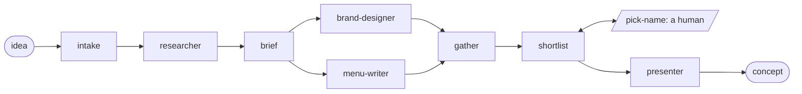
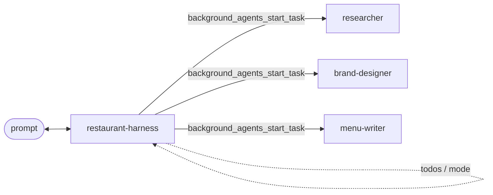

# Idea → Restaurant (Agent Framework + Aspire + DevUI demo)

A demo that turns a single idea into a restaurant concept with research, a brand and a menu. It's built with
[Microsoft Agent Framework](https://learn.microsoft.com/agent-framework/) (not Semantic Kernel), uses
[Aspire](https://aspire.dev) to run it, and you try out the agents in **DevUI**.

## Agents

| Agent (DevUI name) | Project | What it does | Tools |
| --- | --- | --- | --- |
| `researcher` | `src/Mam.Agents.Researcher` | Researches a topic (cuisine, location, trends, competitors) and returns findings with sources | `WebSearch`, `WebFetch` |
| `menu-writer` | `src/Mam.Agents.MenuWriter` | Writes a full restaurant menu that fits the concept and its vibe | `PrintMenu` |
| `brand-designer` | `src/Mam.Agents.BrandDesign` | Turns the idea into a visual brand: name, tagline, vibe, palette, typography, logo | `GenerateImage` |
| `restaurant-workflow` | `src/Mam.Workflow` | Workflow: turns an idea into a complete concept using all agents (see below) | - |
| `restaurant-harness` | `src/Mam.Agents.Harness` | Harness agent: a lead that plans and delegates to the three agents itself (see below) | todos, modes, background agents |

Each agent project contains its own definition (instructions and tools) in the `Mam.Agents.<Agent>` namespace, e.g.
`ResearcherAgent` in `Mam.Agents.Researcher`. Each agent runs in its own ASP.NET Core service. It's created with `AIProjectClient.AsAIAgent(...)` and exposed through OpenAI-compatible
Responses/Conversations endpoints (`Microsoft.Agents.AI.Hosting.OpenAI`). The Aspire AppHost connects all
services to a single **DevUI** resource.

The tools live in each agent project's `Tools` folder. `GenerateImage` is real: it calls the `gpt-image-2.5-flare` deployment
in the same Foundry account. The account-level `/openai/v1` endpoint is used because the project endpoint doesn't
serve image generation. The images are saved to `%TEMP%\mam-images` and served by the agent service at `/images/{file}`.
DevUI's Markdown renderer doesn't show inline images, so the agents return them as links. The agent runs tool calls
concurrently (`AllowConcurrentInvocation`), so the three logos (one per name option), the mood board and the interior picture are generated in parallel (~20 s).
The other tools are still stubs that return canned data.

```text
src/
  Mam.AppHost/                 Aspire AppHost: existing Foundry account + project, agent services, workflow, DevUI
  Mam.ServiceDefaults/         Health checks, OpenTelemetry, service discovery, AddFoundryProjectClient(...), CreateFoundryAgent(...)
  Mam.Agents.Researcher/       researcher agent + its tools
  Mam.Agents.MenuWriter/       menu-writer agent + its tools
  Mam.Agents.BrandDesign/      brand-designer agent + its tools
  Mam.Workflow/                restaurant-workflow: the agents tied together, incl. the presenter (Mam.Agents.Presenter)
  Mam.Agents.Harness/          restaurant-harness: a HarnessAgent that delegates to the agents, hosted for DevUI
  Mam.Agents.Harness.Console/  the same harness agent in a full-screen terminal UI, for live demos
```

## The workflow

`restaurant-workflow` turns one idea into a full restaurant concept:



- **intake** (code): accepts the user's idea from the chat and starts the researcher.
- **researcher** (agent): researches the idea.
- **brief** (code): passes the idea and the research to the brand designer and the menu writer, which run **in parallel** (fan-out).
- **gather** (code): waits for both (fan-in barrier), merges the results and passes them on.
- **shortlist** (code + a small extractor agent): pulls the three name options (each with its own logo) out of the
  brand designer's answer and asks a human to pick one. The workflow **pauses** until someone does.
- **pick-name** (request port): the human in the loop. See [Picking the name](#picking-the-name).
- **presenter** (agent): turns everything into a polished pitch with the picked name. This is the workflow's output.

Executors are the building blocks of a workflow. They can be agents (`agent.BindAsExecutor(...)`) or plain code
(`Executor<T>` / `ChatProtocolExecutor`). Edges connect them in `WorkflowBuilder`. Agents in a workflow use the
*chat protocol*: they collect chat messages and start working when they receive a `TurnToken`.

The workflow is registered with `builder.AddWorkflow(...).AddAsAIAgent()`, so it behaves like any other agent:
DevUI talks to it over the same Responses endpoint, and your idea is just the chat message. The workflow service
references the agent projects and hosts its own in-process instances of the agents, so one run shows up as a single trace in the
Aspire dashboard.

Only the presenter streams into the chat. Streaming several agents would mix their text into one chat message.
The other steps appear in DevUI's **Events** panel (and in **Traces**) as they finish. A run takes about 2-3 minutes.

### Picking the name

The `pick-name` request port is the workflow's human-in-the-loop step. You can answer it in two ways:

- **On the board**: click one of the three logo cards, or press `1`, `2` or `3`.
- **In the chat (DevUI)**: the shortlist appears as a message ("reply with 1 to 3"). Reply with a number or a name.
  The intake sees that a pick is open (shared workflow state) and forwards your reply to the shortlist step.
  The Responses hosting doesn't surface workflow requests as approvals yet, so DevUI can't answer the port directly.

### The workflow board (for live demos)

DevUI's C# version only shows the workflow as a list of events. The workflow service also serves a full-screen
**board** at `/board/` (the **Workflow board** link on the `restaurant-workflow` resource in the Aspire dashboard). It runs
the same workflow, built by `RestaurantWorkflow.Build`, and shows it like a kitchen pass:

- the graph, read from the workflow definition, lights up as executors start and finish;
- every agent streams into its own ticket on the rail, with tool calls and generated images as they arrive;
- when the workflow pauses, the three name options appear as logo cards for the audience to vote on;
- the presenter's pitch ends the run as the final concept sheet.

Type an idea and press **Fire the order**, or use **New order** to start over. Every run has a link (`/board/#run=<id>`)
that replays it, so you can show a finished run again without waiting. Runs are kept in memory until the service restarts.

Suggested demo: open the board full screen, ask the audience for an idea, fire it, talk through the fan-out while the
brand designer and menu writer stream side by side, let the room shout a number for the name, then show the concept.

## The harness agent

`restaurant-harness` gets the same job done in a different way. In the workflow, the steps are wired up in code.
The harness is one lead agent ([`HarnessAgent`](https://learn.microsoft.com/agent-framework/concepts/harness?pivots=programming-language-csharp),
package `Microsoft.Agents.AI.Harness`) that decides for itself which agents to call, in which order and with what input.
Ask for "just a menu" and it only calls the menu writer.



The harness adds these tools to the lead (defined in `src/Mam.Agents.Harness/RestaurantHarnessAgent.cs`):

- **Todos** (`todos_add`, `todos_complete`, ...): the lead tracks its plan as a todo list.
- **Modes** (`mode_set`): it starts in **plan** mode, where it proposes a plan and asks at most two questions.
  In **execute** mode it does the work.
- **Background agents** (`background_agents_start_task`, `..._wait_for_first_completion`, `..._get_task_results`, ...):
  the researcher, brand designer and menu writer run as concurrent tasks. The lead researches first, then runs the
  brand designer and the menu writer in parallel, and writes the final pitch itself.

The specialists are in-process instances of the same agent definitions the workflow uses. Web search and Agent Skills
are turned off for the lead, and its plan files go to `%TEMP%\mam-harness-memory`.

### Run it in the terminal (for live demos)

DevUI only shows the final answer of a run. The terminal UI shows every step live: the mode, each tool call (with the
agent and the task it gets), the todos and the token usage. The UI is the sample console from the
[Agent Framework Harness samples](https://github.com/microsoft/agent-framework/tree/main/dotnet/samples/02-agents/Harness),
copied into `src/Mam.Agents.Harness.Console/HarnessConsole`.

```bash
dotnet run --project src/Mam.Agents.Harness.Console
```

It reads the Foundry endpoint and deployments from `src/Mam.AppHost/appsettings.json`, so you don't need to start
the AppHost. Run it in a real terminal (e.g. Windows Terminal), not inside Aspire, because it needs keyboard input.
Images are linked as `file://` URLs; Ctrl+click opens them.

- Type `/mode execute` first to skip the planning questions, or stay in plan mode to show the plan, then approve it.
- `/todos` shows the todo list and `/exit` quits.
- A run takes about 2-3 minutes.

## Prerequisites

- .NET 10 SDK
- Optional: the [Aspire CLI](https://aspire.dev/get-started/install-cli/), for `aspire run`. You can also use `dotnet run` or F5.
- An existing **Microsoft Foundry** account with a **project**, a `gpt-4.1` model deployment and a
  `gpt-image-2.5-flare` image deployment
- Azure CLI signed in (`az login`). Your user needs the **Azure AI User** role (or higher) on the Foundry project.

## Configure

Set the Foundry project endpoint in `src/Mam.AppHost/appsettings.json`. You can also use user secrets, or enter
it when the Aspire dashboard asks for it.

```json
{
  "ConnectionStrings": {
    "project": "Endpoint=https://<foundry-account>.services.ai.azure.com/api/projects/<project>"
  },
  "Parameters": {
    "modelDeployment": "gpt-4.1",
    "imageDeployment": "gpt-image-2.5-flare",
    "printMenus": "false"
  }
}
```

The AppHost passes this to each agent as `ConnectionStrings__project`. It's a plain connection string, so Aspire
doesn't provision or deploy anything to Azure. The agents and the image tool use one shared
`AzureCliCredential`, which uses your `az login` (no API keys). `DefaultAzureCredential` made the first request after
startup take about 2 minutes on a dev machine, because it probes other credential sources first. In production, use
e.g. `ManagedIdentityCredential`.

### Printing menus

The menu writer's `PrintMenu` tool prints the menu on a 4" x 6" label printer (`PM-241-BT` by default; set the
`MENU_PRINTER` environment variable to use another printer). The font shrinks until the menu fits on one label;
if it still doesn't fit at 4.5pt, the rest is cut off. Printing is off by default (trees are expensive): set the
`printMenus` parameter to `true` to print. When it's off, the menu is only logged. Printing only works on Windows.

## Run

From the repository root:

```bash
aspire run
# or
dotnet run --project src/Mam.AppHost
```

Open the **devui** URL in the Aspire dashboard, pick an agent and start chatting. The dashboard **Traces** view
shows every agent run and tool call, because each agent is wrapped with `UseOpenTelemetry()`.

### Demo prompts

- **researcher**: *"Research the market for a Korean-Mexican fusion street food restaurant in Rotterdam."*
- **brand-designer**: *"Create a brand for a cosy, late-night Korean-Mexican taqueria aimed at students."*
- **menu-writer**: *"Write a menu for 'Seoul Taco', a playful Korean-Mexican street food spot. Mid-range prices."*
- **restaurant-workflow**: *"Let's make a restaurant that's an homage of early medieval times around current-day Utrecht."*
- **restaurant-harness**: *"A tapas bar themed around Dutch Golden Age painters."* (full concept: all three agents)
- **restaurant-harness**: *"Just write a menu for a vegan ramen bar in Ghent."* (only the menu writer)

Avoid brand names and film studios in prompts; the model may refuse them.

## Gotcha: agent names

The agent name passed to `WithAgentService(..., agents: [new("<name>")])` in the AppHost must match
`AddAIAgent("<name>", ...)` in the service. Otherwise DevUI returns 404s. In this repo, the Aspire resource names
are the same as the agent names to keep it simple.
