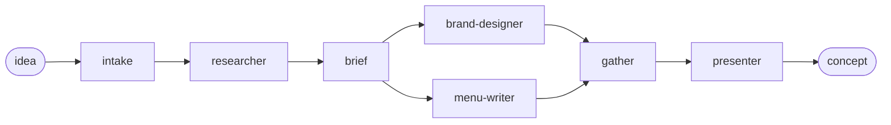

# Idea → Restaurant (Agent Framework + Aspire + DevUI demo)

A demo that turns a single idea into a restaurant concept with research, a brand and a menu. It's built with
[Microsoft Agent Framework](https://learn.microsoft.com/agent-framework/) (not Semantic Kernel), uses
[Aspire](https://aspire.dev) to run it, and you try out the agents in **DevUI**.

All packages come from NuGet (`Microsoft.Agents.AI.Foundry`, `Aspire.Hosting.AgentFramework.DevUI`, `Microsoft.Agents.AI.DevUI`, ...).
You don't need a clone of the Agent Framework repo.

## Agents

| Agent (DevUI name) | Project | What it does | Tools |
|---|---|---|---|
| `researcher` | `src/Mam.Researcher` | Researches a topic (cuisine, location, trends, competitors) and returns findings with sources | `WebSearch`, `WebFetch` |
| `menu-writer` | `src/Mam.MenuWriter` | Writes a full restaurant menu that fits the concept and its vibe | `PrintMenu` |
| `brand-designer` | `src/Mam.BrandDesign` | Turns the idea into a visual brand: name, tagline, vibe, palette, typography, logo | `GenerateImage` |
| `restaurant-workflow` | `src/Mam.Workflow` | Workflow: turns an idea into a complete concept using all agents (see below) | - |

The agent definitions (instructions and tools) live in the shared `Mam.Agents` library. Each agent runs in its own
ASP.NET Core service. It's created with `AIProjectClient.AsAIAgent(...)` and exposed through OpenAI-compatible
Responses/Conversations endpoints (`Microsoft.Agents.AI.Hosting.OpenAI`). The Aspire AppHost connects all
services to a single **DevUI** resource.

The tools live in `src/Mam.Agents/Tools`. `GenerateImage` is real: it calls the `gpt-image-2.5-flare` deployment
in the same Foundry account. The account-level `/openai/v1` endpoint is used because the project endpoint doesn't
serve image generation. The images are saved to `%TEMP%\mam-images` and served by the agent service at `/images/{file}`.
DevUI's Markdown renderer doesn't show inline images, so the agents return them as links. The agent runs tool calls
concurrently (`AllowConcurrentInvocation`), so the logo, the mood board and the interior picture are generated in parallel (~20 s).
The other tools are still stubs that return canned data.

```
src/
  Mam.AppHost/          Aspire AppHost: existing Foundry account + project, agent services, workflow, DevUI
  Mam.ServiceDefaults/  Health checks, OpenTelemetry, service discovery, AddFoundryProjectClient(...)
  Mam.Agents/           Shared agent definitions (instructions + stub tools), incl. the presenter
  Mam.Researcher/       researcher agent
  Mam.MenuWriter/       menu-writer agent
  Mam.BrandDesign/      brand-designer agent
  Mam.Workflow/         restaurant-workflow: the agents tied together
```

## The workflow

`restaurant-workflow` turns one idea into a full restaurant concept:



- **intake** (code): accepts the user's idea from the chat and starts the researcher.
- **researcher** (agent): researches the idea.
- **brief** (code): passes the idea and the research to the brand designer and the menu writer, which run **in parallel** (fan-out).
- **gather** (code): waits for both (fan-in barrier), merges the results and passes them on.
- **presenter** (agent): turns everything into a polished pitch. This is the workflow's output.

Executors are the building blocks of a workflow. They can be agents (`agent.BindAsExecutor(...)`) or plain code
(`Executor<T>` / `ChatProtocolExecutor`). Edges connect them in `WorkflowBuilder`. Agents in a workflow use the
*chat protocol*: they collect chat messages and start working when they receive a `TurnToken`.

The workflow is registered with `builder.AddWorkflow(...).AddAsAIAgent()`, so it behaves like any other agent:
DevUI talks to it over the same Responses endpoint, and your idea is just the chat message. The workflow service
hosts its own in-process instances of the agents from `Mam.Agents`, so one run shows up as a single trace in the
Aspire dashboard.

Only the presenter streams into the chat. Streaming several agents would mix their text into one chat message.
The other steps appear in DevUI's **Events** panel (and in **Traces**) as they finish. A run takes about 2-3 minutes.

## Prerequisites

- .NET 10 SDK
- Optional: the [Aspire CLI](https://aspire.dev/get-started/install-cli/), for `aspire run`. You can also use `dotnet run` or F5.
- An existing **Microsoft Foundry** account with a **project**, a `gpt-4.1` model deployment and a
  `gpt-image-2.5-flare` image deployment
- Azure CLI signed in (`az login`). Your user needs the **Azure AI User** role (or higher) on the Foundry project.

## Configure

Set the Foundry project endpoint in `src/Mam.AppHost/appsettings.json`. You can also use user secrets, or enter
it when the Aspire dashboard asks for it.

```json
{
  "ConnectionStrings": {
    "project": "Endpoint=https://<foundry-account>.services.ai.azure.com/api/projects/<project>"
  },
  "Parameters": {
    "modelDeployment": "gpt-4.1",
    "imageDeployment": "gpt-image-2.5-flare"
  }
}
```

The AppHost passes this to each agent as `ConnectionStrings__project`. It's a plain connection string, so Aspire
doesn't provision or deploy anything to Azure. The agents and the image tool use one shared
`AzureCliCredential`, which uses your `az login` (no API keys). `DefaultAzureCredential` made the first request after
startup take about 2 minutes on a dev machine, because it probes other credential sources first. In production, use
e.g. `ManagedIdentityCredential`.

## Run

From the repository root:

```bash
aspire run
# or
dotnet run --project src/Mam.AppHost
```

Open the **devui** URL in the Aspire dashboard, pick an agent and start chatting. The dashboard **Traces** view
shows every agent run and tool call, because each agent is wrapped with `UseOpenTelemetry()`.

### Demo prompts

- **researcher**: *"Research the market for a Korean-Mexican fusion street food restaurant in Rotterdam."*
- **brand-designer**: *"Create a brand for a cosy, late-night Korean-Mexican taqueria aimed at students."*
- **menu-writer**: *"Write a menu for 'Seoul Taco', a playful Korean-Mexican street food spot. Mid-range prices."*
- **restaurant-workflow**: *"Let's make a restaurant that's an homage of early medieval times around current-day Utrecht."*
- **restaurant-workflow**: *"Let's make a restaurant that's an homage of early medieval times around current-day Utrecht."*

## Gotcha: agent names

The agent name passed to `WithAgentService(..., agents: [new("<name>")])` in the AppHost must match
`AddAIAgent("<name>", ...)` in the service. Otherwise DevUI returns 404s. In this repo, the Aspire resource names
are the same as the agent names to keep it simple.
